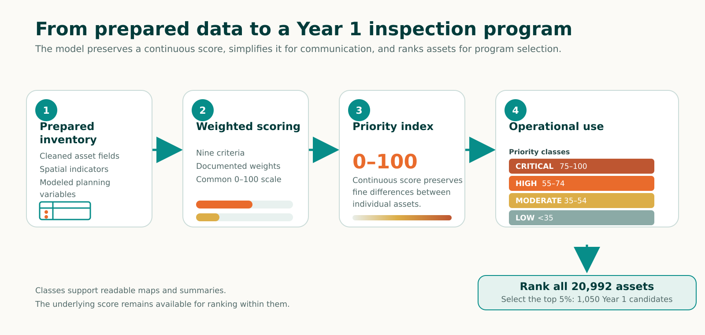
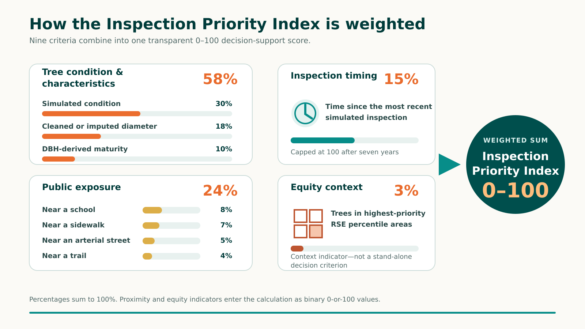

# Prioritizing Seattle's Public Tree Inspections

An independent GIS portfolio project that demonstrates how a citywide public-tree inventory can be translated into a transparent, repeatable inspection-priority model and a manageable Year 1 program.

> **Portfolio context:** This project uses publicly available data, simulated planning variables, and modeled assumptions. It does not diagnose tree health, predict tree failure, or represent an official City of Seattle inspection plan.

## Explore the project

- **StoryMap:** [Explore the complete project](https://storymaps.arcgis.com/stories/5922814130cb4af689ecb57017f72b75)
- **Citywide priority map:** [Explore modeled priorities across Seattle](https://arcg.is/0PbDeq0)
- **Year 1 operational dashboard:** [Open the dashboard](https://www.arcgis.com/apps/dashboards/72ea68c240d74390a2beb1f634fe800d)
- **ArcGIS portfolio:** [View Ava Gotthard's ArcGIS portfolio](https://arcgotthard.maps.arcgis.com)

## Project overview

Seattle manages a large and geographically dispersed public tree inventory. Inspecting every asset at the same frequency is rarely practical, so urban forestry programs must decide where limited staff time and field resources may provide the greatest value.

This project combines tree characteristics, modeled condition and inspection timing, proximity to public infrastructure, and neighborhood equity context into a continuous **Inspection Priority Index** ranging from 0 to 100. The index supports detailed ranking, while four broader priority classes make the results easier to map and communicate.

The highest-ranked 5 percent of assets were selected to demonstrate how citywide analysis could be translated into a first-year inspection cohort.

## Key results

| Result | Value |
|---|---:|
| Modeled public tree assets | 20,992 |
| Trees selected for Year 1 | 1,050 |
| Critical-priority assets selected | 261 |
| High-priority assets selected | 789 |
| Average Year 1 priority score | 72.4 |
| Estimated direct inspection time | 822 hours |
| Average modeled time per selected asset | Approximately 47 minutes |

## Analytical workflow

1. Standardize the source inventory and preserve original measurements.
2. Create cleaned, derived, spatial, and simulated planning variables.
3. Express nine criteria on a common 0-100 scale.
4. Apply documented weights and calculate a continuous priority score.
5. Group scores into four classes for mapping and communication.
6. Rank all assets and select the highest-scoring 5 percent for the modeled Year 1 program.

The data-preparation workflow is shown in [`images/data_preparation_workflow.png`](images/data_preparation_workflow.png). Detailed methods are documented in [`docs/model_methodology.md`](docs/model_methodology.md).

## Model components

| Component | Criterion | Weight |
|---|---|---:|
| Tree condition and characteristics | Simulated condition | 30% |
| Tree condition and characteristics | Cleaned or imputed diameter | 18% |
| Tree condition and characteristics | DBH-derived maturity | 10% |
| Inspection timing | Time since the most recent simulated inspection | 15% |
| Public exposure | Near a school | 8% |
| Public exposure | Near a sidewalk | 7% |
| Public exposure | Near an arterial street | 5% |
| Public exposure | Near a trail | 4% |
| Equity context | Highest-priority Racial and Social Equity Index areas | 3% |

The weights sum to 100 percent. Proximity and equity indicators enter the calculation as binary values expressed on the same 0-100 scale as the continuous criteria.

## Priority classes

| Class | Score range |
|---|---:|
| Critical | 75-100 |
| High | 55-74 |
| Moderate | 35-54 |
| Low | Below 35 |

The continuous score remains the basis for ranking assets within and across these communication classes.

## Repository structure

- `notebooks/` — six ordered ArcGIS Pro notebooks used to prepare, score, select, and publish the assets
- `docs/` — methodology, sources, data dictionary, and limitations
- `images/` — final workflow, model, dashboard, and limitation graphics
- `data/README.md` — instructions for obtaining source data without redistributing large datasets
- `environment.yml` — documented Python dependencies

## Reproducing the analysis

1. Install ArcGIS Pro and create a clone of its default `arcgispro-py3` environment.
2. Review `environment.yml` and install any listed packages that are not already available in the clone.
3. Download the source datasets described in [`docs/data_sources.md`](docs/data_sources.md).
4. Store local inputs outside version control and update the notebook configuration paths.
5. Copy the six final notebooks into `notebooks/` and run them in numerical order.
6. Compare record counts and summary statistics with the values reported above before publishing derived layers.

The workflow relies on Esri's Python ecosystem and may include `arcpy`, which is licensed and distributed with ArcGIS Pro rather than through a general-purpose Python installation.

## Documentation

- [Model methodology](docs/model_methodology.md)
- [Data sources](docs/data_sources.md)
- [Core data dictionary](docs/data_dictionary.md)
- [Limitations](docs/limitations.md)
- [Notebook guide](notebooks/README.md)

## Author

**Ava Gotthard, MS GIS**  
Independent GIS analysis, modeling, cartography, dashboard design, and narrative development, 2026.

- [LinkedIn](https://www.linkedin.com/in/agotthard)
- [ArcGIS portfolio](https://arcgotthard.maps.arcgis.com)

## License and data use

Original code and documentation in this repository are released under the [MIT License](LICENSE). Source datasets, basemaps, service layers, and other third-party content remain subject to the terms established by their respective providers. See [`docs/data_sources.md`](docs/data_sources.md) for attribution guidance.

