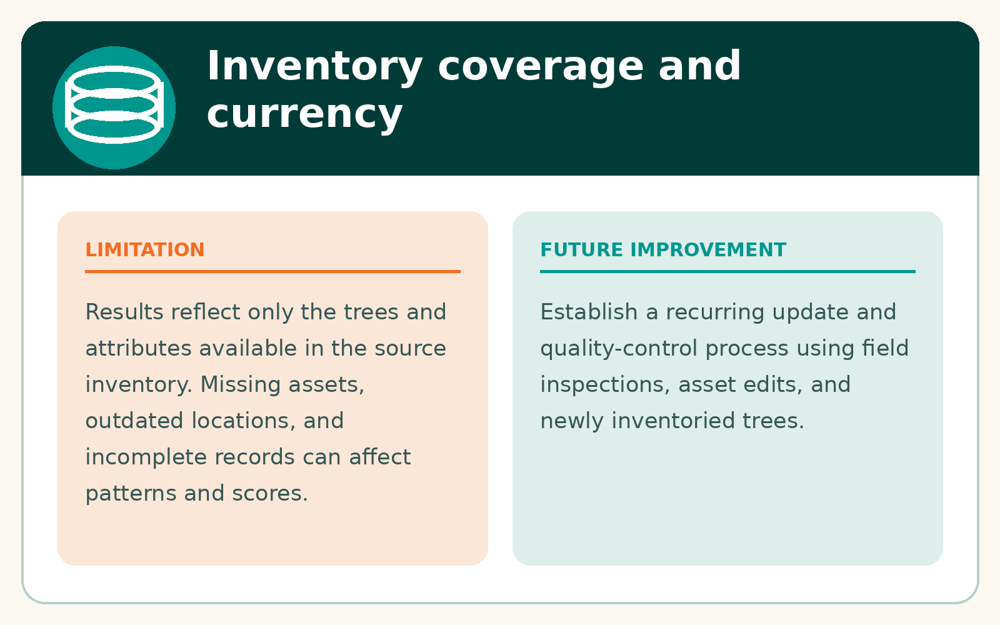
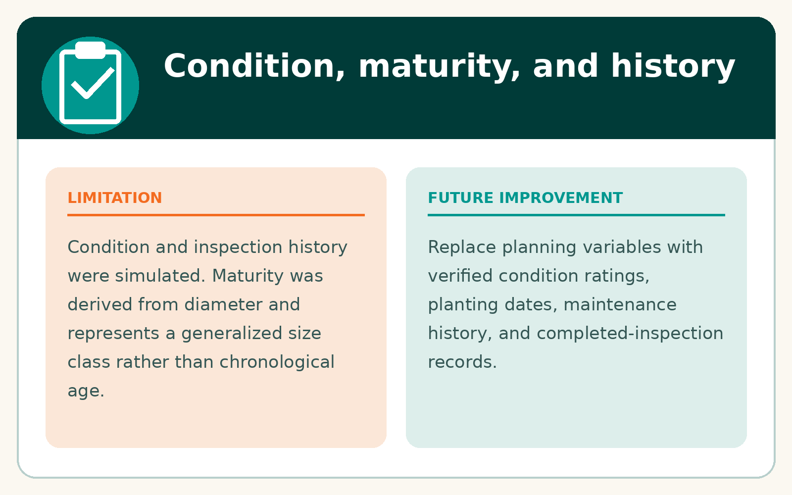
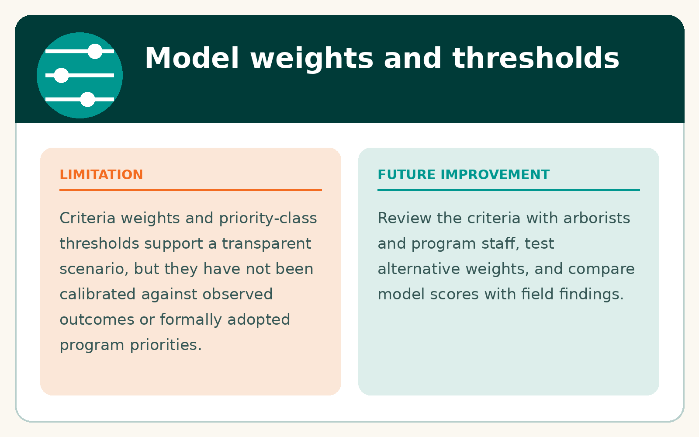
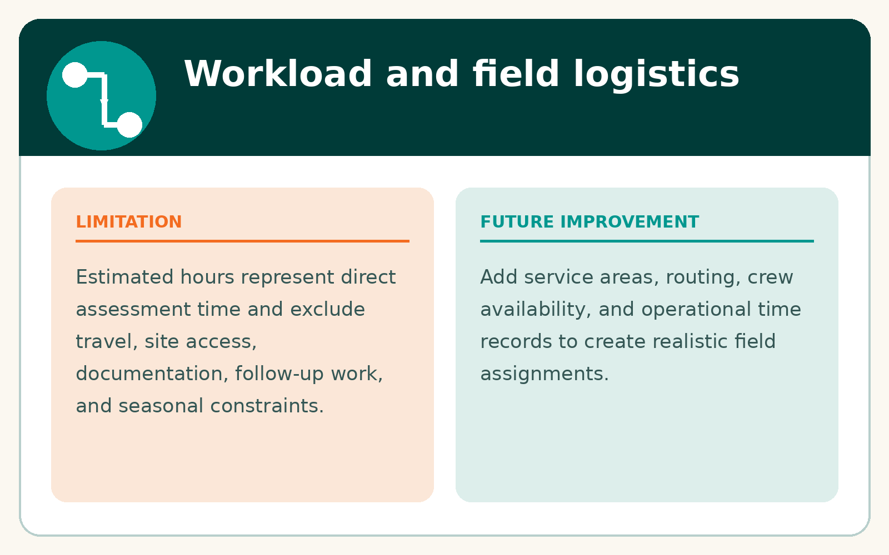

# Limitations and future improvements

## Inventory coverage

The results describe assets present in the source inventory. Gaps, positional uncertainty, incomplete attributes, and differences in collection practices influence the apparent citywide pattern. Areas with fewer inventoried assets should not automatically be interpreted as having fewer inspection needs.

## Modeled variables

Condition and inspection-history information was not complete or consistently populated, so simulated variables were used to demonstrate the prioritization workflow. These values are not field observations and should be replaced with current operational records before real-world use.

## Weights and thresholds

The nine weights, proximity rules, class breaks, and 5 percent program cutoff are documented planning assumptions. They demonstrate a transparent method rather than a formally validated municipal policy. Sensitivity testing and review by urban forestry staff would be appropriate next steps.

## Operational workload

The 822-hour estimate represents modeled direct inspection time. It excludes routing, travel, site access, documentation, coordination, follow-up work, seasonal constraints, and staffing availability. A field-ready program would require operational validation and scheduling analysis.

## Appropriate interpretation

The model prioritizes where inspection may begin. It does not identify confirmed hazards, predict failure, determine treatment, or replace professional field assessment. Equity context is included as one component of resource-allocation planning and is not treated as a measure of individual tree condition.

