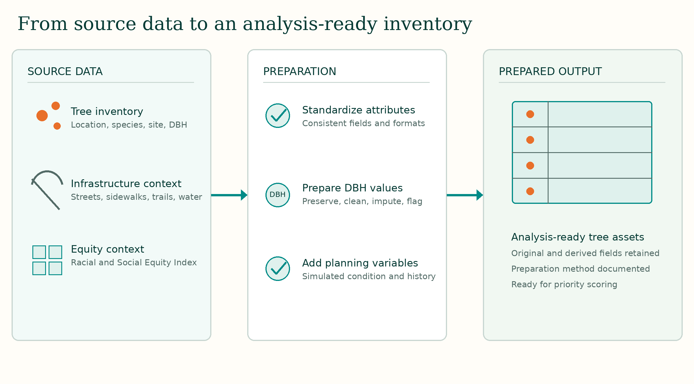

# Model methodology

## Purpose

The Inspection Priority Index is a screening and planning measure designed to compare assets consistently and identify trees that may warrant earlier field assessment. It is not a probability of failure, a diagnosis of tree health, or a substitute for inspection by a qualified arborist.

## Preparation

The workflow begins with the public tree inventory. Original diameter measurements are retained in `DBH_ORIG`. Standardized analytical measurements are stored in `DBH_CLEAN`, while fallback values are stored separately in `DBH_IMPUTED`. `DBH_METHOD` records whether the analytical value came from the source inventory or an imputation step. Diameter information is also used to derive a generalized `MATURITY` class.

Infrastructure and neighborhood context are joined to the tree-level dataset through spatial relationships. Where complete condition and inspection-history attributes were unavailable, clearly identified simulated variables were created to demonstrate the full prioritization workflow.



## Criteria and weights

Each criterion is expressed as either a 0-100 score or a binary 0-or-100 indicator. Weighted components are added to produce a final 0-100 index.

| Component | Criterion | Weight |
|---|---|---:|
| Tree condition and characteristics | Simulated condition | 30% |
| Tree condition and characteristics | Cleaned or imputed DBH | 18% |
| Tree condition and characteristics | DBH-derived maturity | 10% |
| Inspection timing | Time since simulated inspection | 15% |
| Public exposure | Near a school | 8% |
| Public exposure | Near a sidewalk | 7% |
| Public exposure | Near an arterial street | 5% |
| Public exposure | Near a trail | 4% |
| Equity context | Highest-priority RSE areas | 3% |

The weighted form of the index is:

```text
Priority Index =
  0.30 × condition score
+ 0.18 × DBH score
+ 0.10 × maturity score
+ 0.15 × inspection-timing score
+ 0.08 × school proximity indicator
+ 0.07 × sidewalk proximity indicator
+ 0.05 × arterial proximity indicator
+ 0.04 × trail proximity indicator
+ 0.03 × equity-context indicator
```

Time since the most recent simulated inspection is capped at 100 after seven years. The implementation details and precise spatial thresholds should be documented in the corresponding notebooks.

## Priority classes

The continuous index is retained for ranking. Four classes simplify mapping and communication:

- Critical: 75-100
- High: 55-74
- Moderate: 35-54
- Low: below 35

Across 20,992 modeled assets, scores ranged from 8 to 92, with a citywide average of 41.9.

## Year 1 selection

Assets are ranked by their continuous priority score. The highest-ranked 5 percent form the modeled Year 1 cohort of 1,050 trees. The cohort includes all 261 Critical assets and the 789 highest-ranked High-priority assets.

Individual inspection-time estimates account for tree diameter and simulated condition. Summing those estimates produces approximately 822 hours of direct inspection work, or about 47 minutes per selected asset. The total excludes travel, access constraints, documentation, follow-up work, and other operational demands.

